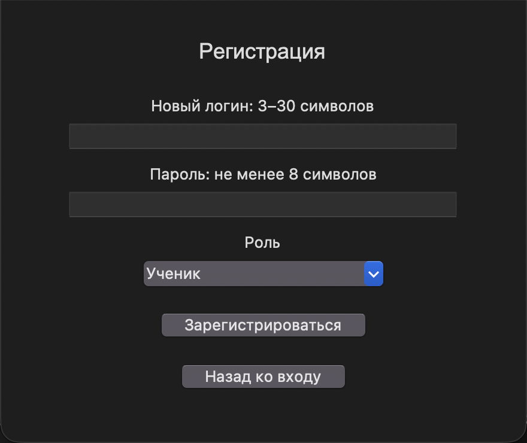
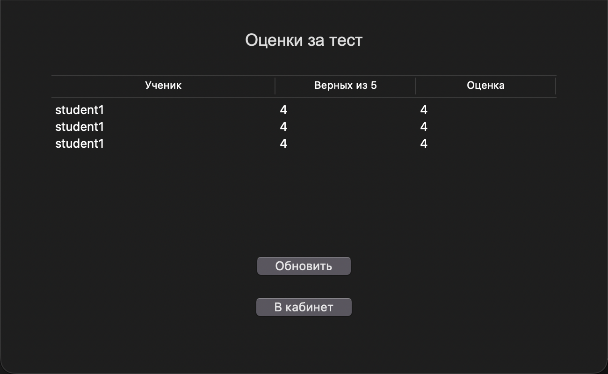

# Практическая работа «Простая система тестирования»

Создайте приложение на Python с Tkinter и PostgreSQL. В нём две роли: **ученик** и **преподаватель**. Ученик проходит один готовый тест и видит свои оценки. Преподаватель смотрит результаты всех учеников.

Для этой работы достаточно одного окна: при переходе можно очищать его содержимое и показывать другую форму. Пишите обычные функции, без собственных классов.

## 1. Вход

На форме два поля: **логин** и **пароль**. Ниже кнопки **«Войти»** и **«Создать аккаунт»**.

По нажатию «Войти» найдите пользователя в БД и проверьте пароль. Роль возьмите из найденной записи: ученик открывает свой кабинет, преподаватель — свой. При неверном логине или пароле покажите предупреждение.

Выбирать роль при входе и выбирать преподавателя ученику не нужно.

## 2. Регистрация

На форме:

- Новый логин: от 3 до 30 символов.
- Пароль: не менее 8 символов.
- Роль из списка: «Ученик» или «Преподаватель».
- Кнопки «Зарегистрироваться» и «Назад ко входу».

Пустые/слишком короткие значения и занятый логин не сохраняйте. Приводите логин к нижнему регистру при регистрации и входе. После регистрации верните пользователя к форме входа.

Для защиты пароля возьмите готовый файл password_tools.py из материалов. Он создаёт хеш и проверяет пароль; писать этот вспомогательный код самостоятельно не требуется.

## 3. Кабинет ученика и тест

Кнопки кабинета: **«Пройти тест»**, **«Мои оценки»**, **«Выйти»**.

1. По кнопке «Пройти тест» загрузите из БД пять готовых вопросов.
2. Покажите у каждого четыре варианта и дайте выбрать один через Radiobutton.
3. По кнопке «Завершить тест» проверьте, что ответы выбраны во всех пяти вопросах. При пропуске покажите предупреждение.
4. Посчитайте правильные ответы и определите оценку.
5. Сохраните логин ученика, число правильных ответов и оценку в БД.
6. Покажите результат: например, «Верных ответов: 4 из 5. Оценка: 4».

Шкала простая: 5 правильных → оценка 5; 4 → 4; 3 → 3; от 0 до 2 → 2.

Сначала сравнение выполняется в Python. За каждое совпадение счётчик увеличивается на 1. Затем INSERT сохраняет итог. Сохраняются все завершённые результаты, даже ноль правильных ответов. При пропуске результат пока не сохраняется.

После сохранения выключите кнопку завершения, чтобы повторный щелчок не добавил ту же запись. Новое прохождение разрешено и сохраняется новой строкой. До завершения оценку не показывайте.

## 4. Оценки ученика

По кнопке «Мои оценки» покажите Treeview с тремя столбцами: **Ученик · Верных из 5 · Оценка**. Загрузите только результаты вошедшего ученика. Кнопка «Обновить» повторно читает БД, «В кабинет» возвращает назад.

## 5. Кабинет преподавателя

Кнопки кабинета: **«Все результаты»** и **«Выйти»**.

По кнопке «Все результаты» покажите такую же таблицу из трёх столбцов, но с результатами всех учеников. Добавьте «Обновить» и «В кабинет».

Преподаватель только смотрит результаты. Редактор вопросов в этой работе не требуется: вопросы уже заполнены через SQL. Ученик видит только свои результаты.

## 6. База данных

Достаточно трёх таблиц:

- users: login, password_hash, role.
- questions: id, question, answer_1, answer_2, answer_3, answer_4, correct.
- results: id, student_login, score, grade.

correct — номер правильного варианта от 1 до 4. score — количество верных ответов от 0 до 5. grade — оценка. id в results автоматически выдаётся через SERIAL.

Используйте простые TEXT, INTEGER и SERIAL. Для работы достаточно CREATE TABLE, INSERT, SELECT, WHERE и ORDER BY. Готовые команды создания таблиц и заполнения пяти вопросов даны в пошаговых материалах. JOIN, внешние ключи, даты, отдельное сохранение каждого ответа и история изменения вопросов не нужны.

Данные должны оставаться после закрытия программы. Пользовательские значения передавайте в запросы через %s и отдельный кортеж параметров, как показано в примерах. Ошибку подключения показывайте сообщением, чтобы программа не закрывалась аварийно.

## 7. Как собирать

Откройте папку tk_system в репозитории Materials. Там пошагово собирается именно эта простая программа, в одном файле app.py. Идите по документам 01–05 по порядку. Каждый фрагмент объясняет, в какой файл и куда добавить строки.

Готовые settings_example.py и password_tools.py разрешается взять из материалов. Создайте копию settings_example.py с именем settings.py и укажите свои параметры PostgreSQL. Не нужно писать защиту пароля с нуля.

## 8. Что проверить и показать

1. Регистрация создаёт ученика и преподавателя. Повторный логин вызывает предупреждение.
2. Неверный пароль не позволяет войти. Правильный вход открывает кабинет нужной роли.
3. Тест содержит пять вопросов, в каждом выбирается один ответ.
4. С пропуском тест не завершается. Без пропусков результат сохраняется и появляется оценка.
5. За 5, 4, 3 и 2 правильных ответа получаются оценки 5, 4, 3 и 2.
6. Ученик видит свои оценки, преподаватель — все результаты. Новое прохождение добавляет строку.
7. После закрытия и запуска результаты остаются в БД.

Сдайте папку с программой, SQL создания таблиц и заполнения вопросов, а также укажите логины демонстрационного ученика и преподавателя. Параметры своего подключения храните в settings.py.
