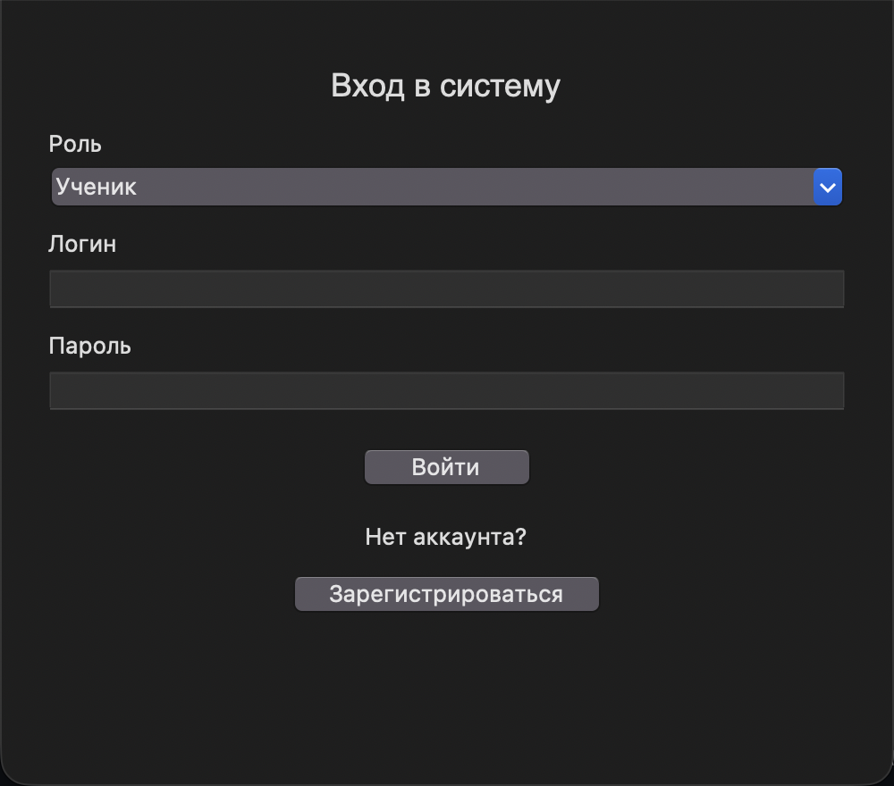
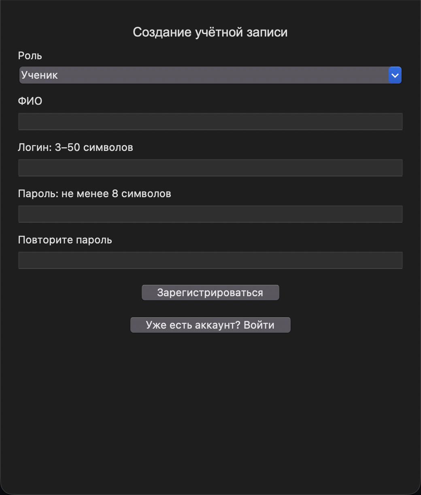
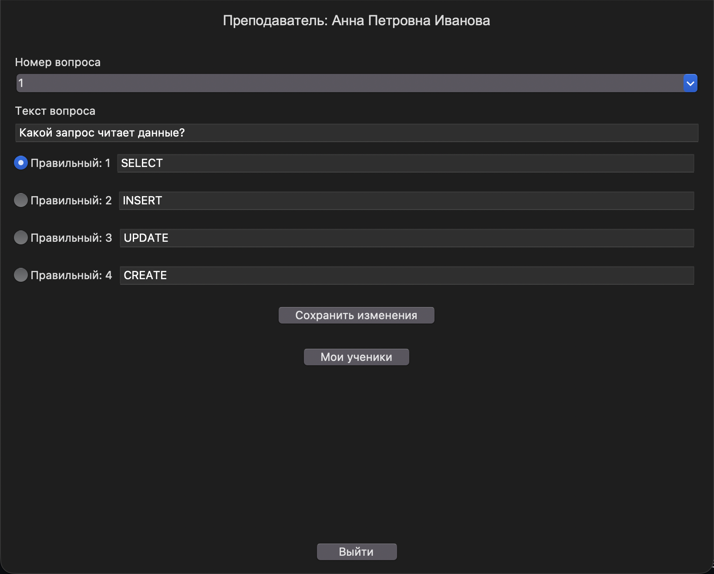
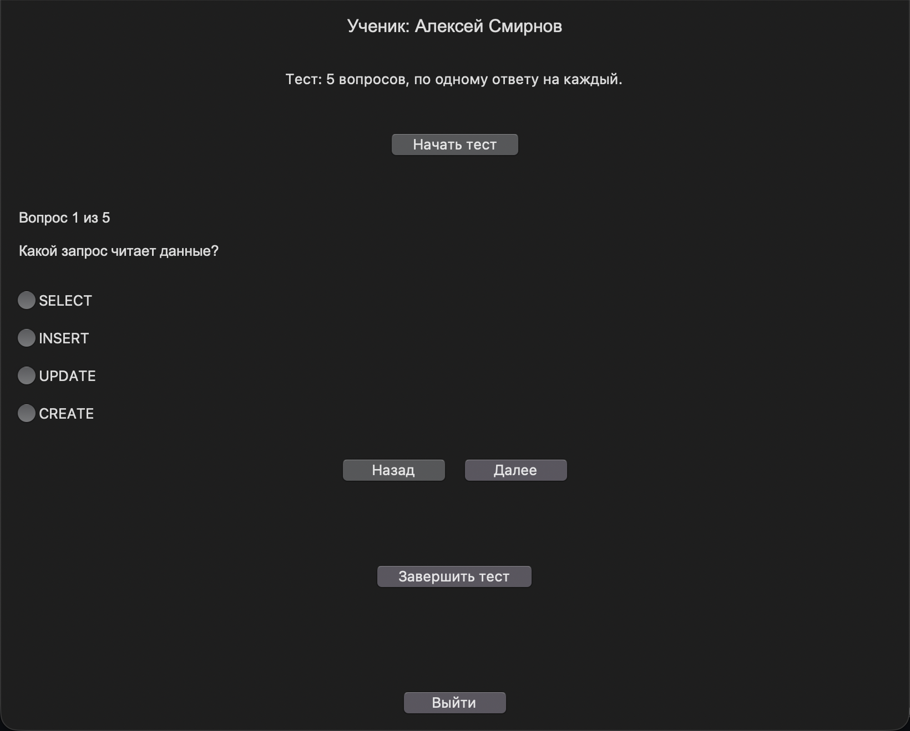
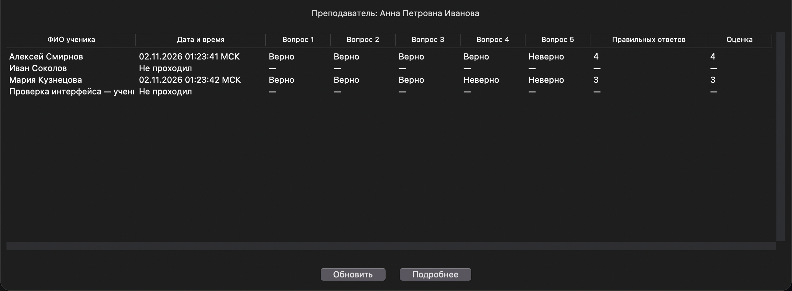

# Практическое задание «Система тестирования учащихся»

**Разработайте приложение на Python с графическим интерфейсом Tkinter и базой данных PostgreSQL.** В приложении должны работать авторизация и регистрация с выбором роли, тест из пяти вопросов, редактор вопросов и просмотр успеваемости.

В системе две роли: **ученик** и **преподаватель**. **Тест один общий для всех учеников. Выбирать преподавателя при регистрации не нужно. Все преподаватели редактируют общий тест и видят результаты всех учеников.** Предмет тестирования можно выбрать самостоятельно. В схемах приведён пример по основам SQL.

## 1. Первое окно — вход и регистрация



При запуске покажите форму входа. Под кнопкой «Войти» разместите надпись **«Нет аккаунта?»** и кнопку **«Зарегистрироваться»**. По нажатию открывается форма регистрации: в отдельном окне либо на другой вкладке.

### Вход

1. Пользователь выбирает роль **«Ученик»** или **«Преподаватель»** из выпадающего списка, вводит логин и пароль, затем нажимает **«Войти»**.
2. Приложение проверяет данные по БД.
3. После успешного входа открывается кабинет, соответствующий роли пользователя.
4. При неверных данных появляется сообщение «Неверный логин или пароль».

В поле **«Роль»** должны быть только два значения: **«Ученик»** и **«Преподаватель»**. Приложение сверяет выбранную роль с ролью учётной записи в БД. Если роль не совпадает, вход запрещается и выводится понятное предупреждение. Выбор преподавателя в списке ролей не даёт ученику доступ к кабинету преподавателя.

### Регистрация с выбором роли



В форме должны быть выпадающий список **«Роль: Ученик / Преподаватель»**, поля «ФИО», «Логин», «Пароль», «Повторите пароль» и кнопка **«Зарегистрироваться»**.

Добавьте кнопку **«Уже есть аккаунт? Войти»**, которая возвращает к форме входа.

- ФИО обязательно для заполнения.
- Логин — от 3 до 50 символов; повторяющиеся логины запрещены. Регистр букв при проверке логина не учитывается.
- Пароль — не менее 8 символов; оба введённых пароля должны совпадать.
- После регистрации учётная запись сохраняется с выбранной ролью. Пользователь возвращается к входу; в форме входа автоматически выбирается та же роль.
- При регистрации нового преподавателя отдельный тест не создаётся: после входа он работает с общим тестом из пяти вопросов. Поля «Ваш преподаватель» в форме нет.

Для демонстрации заранее создайте преподавателя и учеников; также обеспечьте регистрацию обеих ролей через интерфейс. Пароли храните в виде хешей с солью.

## 2. Второе окно — кабинет преподавателя и редактор вопросов



В кабинете покажите ФИО преподавателя, редактор теста, кнопку **«Мои ученики»** и кнопку **«Выйти»**.

Общий тест состоит ровно из **пяти вопросов**. Для каждого вопроса предусмотрено **четыре варианта**, из которых **один правильный**.

Преподаватель должен иметь возможность:

1. Выбрать любой из пяти вопросов.
2. Увидеть текст вопроса и четыре варианта ответа.
3. Увидеть, какой вариант отмечен правильным.
4. Изменить вопрос, варианты и отметку правильного ответа.
5. Нажать **«Сохранить изменения»** и получить сообщение об успешном сохранении.

Не допускайте сохранения пустого вопроса, пустых вариантов или отсутствия правильного ответа. Изменения записываются в БД и используются в новых попытках. Добавление и удаление вопросов в этой работе не требуется.

Все преподаватели редактируют один общий тест и видят всех учеников системы. Ученик получает общий тест. Ученику редактирование и просмотр статистики недоступны.

## 3. Третье окно — кабинет ученика и тест



В кабинете покажите ФИО ученика, кнопку **«Начать тест»** и кнопку **«Выйти»**.

После начала теста:

1. Загрузите из БД пять вопросов и варианты ответа.
2. Покажите вопросы в одном окне с прокруткой либо последовательно.
3. Для каждого вопроса дайте выбрать один вариант ответа, например с помощью переключателей `Radiobutton`.
4. Предусмотрите кнопку **«Завершить тест»**.

Пока ученик не завершил тест, правильные ответы и оценка не показываются. Если хотя бы один ответ не выбран, выведите предупреждение и оставьте возможность продолжить работу.

После завершения автоматически подсчитайте правильные ответы и покажите результат, например: **«Правильных ответов: 4 из 5. Оценка: 4»**.

Шкала оценивания:

- 5 правильных ответов — **5**.
- 4 правильных ответа — **4**.
- 3 правильных ответа — **3**.
- От 0 до 2 правильных ответов — **2**.

Сохраните ученика, дату и время завершения, ответы на пять вопросов, число правильных ответов и оценку. Время в интерфейсе показывайте по Москве.

Повторное прохождение разрешено. Каждое прохождение сохраняется отдельной попыткой. Повторное нажатие кнопки завершения одной попытки не должно создавать дубликат.

Блок результата появляется только после завершения теста.

### Подсказка: как получить и сохранить оценку без JOIN

1. При нажатии «Начать тест» загрузите пять общих вопросов, четыре варианта и правильный номер каждого.
2. Сохраните копию этих данных в памяти текущей попытки. Ученик видит только вопрос и варианты.
3. Получите пять выбранных номеров из Tkinter. Если есть пропуск, покажите предупреждение и не сохраняйте попытку.
4. Сравните выбор с правильным номером из сохранённой копии. За совпадение прибавьте 1 к счётчику Python.
5. Определите оценку, затем сохраните попытку и все пять ответов одной транзакцией. Даже ноль правильных — завершённая попытка с оценкой 2.
6. Для статистики читайте уже сохранённые оценки. Не пересчитывайте их по изменённым вопросам.

Ниже небольшие примеры. Полная пошаговая сборка по строкам находится в папке tk_system репозитория Materials. Файлы идут по порядку от 01_База_и_настройки.md до 06_Словарь.md.

#### Шаг 1. Один SELECT читает общий тест

Варианты можно хранить четырьмя текстовыми полями одной таблицы questions. Для этого учебного задания отдельная таблица вариантов не обязательна.

```sql
SELECT id, position, question_text, option_1, option_2, option_3, option_4, correct_option
FROM questions ORDER BY position;
```

SELECT выбирает поля, FROM задаёт таблицу, ORDER BY задаёт порядок. position — номер вопроса 1–5, correct_option — правильный вариант 1–4. Запрос возвращает пять строк. Соединение таблиц не требуется.

Шаблон для обычного курсора psycopg:

```python
курсор.execute(sql_вопросов)
вопросы = курсор.fetchall()
```

sql_вопросов — строка с запросом выше; её нужно определить перед выполнением. fetchall возвращает все строки. При обычном курсоре вопросы[0][7] — правильный номер первого вопроса. В пошаговой сборке используется dict_row: там можно обращаться по имени поля, например строка['correct_option'].

Сохраните отдельный снимок пяти вопросов, текстов, вариантов и правильных номеров при старте. При завершении используйте его, даже если преподаватель уже изменил общий тест.

#### Шаг 2. Сохраните выбор ученика в Tkinter

Для каждого вопроса нужна своя переменная. Пример для одного вопроса:

```python
выбор = tk.IntVar(value=0)
```

`IntVar` хранит целое число, связанное с переключателями Tkinter. `value=0` означает «ответ ещё не выбран». Создавайте переменные после создания главного окна. В файле должен быть импорт `import tkinter as tk`, а для следующих строк — `from tkinter import ttk`.

Четыре переключателя одного вопроса связываются с одной переменной:

```python
for номер, текст in enumerate(варианты, start=1):
    ttk.Radiobutton(область_вопроса, text=текст, variable=выбор, value=номер).pack(anchor="w")
```

`варианты` — список четырёх текстов из снимка, `область_вопроса` — созданный вами Frame. `enumerate(..., start=1)` даёт номера 1–4. `text` — надпись, `variable` — общая переменная этого вопроса, `value` — число, которое запишется при выборе. `pack` размещает виджет, `anchor="w"` прижимает к левому краю.

Для пяти вопросов создайте пять отдельных `IntVar` и соберите их в список `выборы`. Если использовать одну переменную для всех пяти вопросов, выбор в одном вопросе будет менять выбор в другом.

В обработчике «Завершить тест» получите значения:

```python
ответы_ученика = [переменная.get() for переменная in выборы]
```

`get()` читает текущее значение. Запись в квадратных скобках создаёт список значений пяти переменных. Сначала убедитесь, что их ровно пять и каждый ответ входит в `(1, 2, 3, 4)`. Если есть `0`, покажите предупреждение и завершите обработчик через `return`, сохранив возможность продолжить тест.

#### Шаг 3. Посчитайте совпадения

Для понимания проверьте маленький пример отдельно от интерфейса. В настоящем приложении первый список получается из снимка вопросов, второй — из пяти переменных Tkinter. Порядок вопросов в обоих списках должен совпадать.

```python
правильные_ответы = [1, 2, 3, 4, 1]
ответы_ученика = [1, 2, 4, 4, 1]
```

Здесь ученик ошибся только в третьем вопросе. Номера вариантов начинаются с 1. Эти списки — демонстрационные значения, а не правильные ответы, которые нужно жёстко записать в программе.

Начните счёт с нуля:

```python
количество = 0
```

Сравните пары ответов:

```python
for выбранный, правильный in zip(ответы_ученика, правильные_ответы):
    if выбранный == правильный:
        количество += 1
```

`zip` берёт по одному элементу из каждого списка. `==` проверяет равенство, `if` выполняет вложенную строку только при совпадении, `+= 1` прибавляет единицу. Для примера получится `4`. Перед циклом обязательно проверьте длины: `zip` заканчивает работу по более короткому списку и сам не сообщит о недостающем ответе.

Сохраните также результат сравнения каждого вопроса — он понадобится для столбцов «Верно» и «Неверно», либо получите его позднее из сохранённых выбранного и правильного номеров.

#### Шаг 4. Определите оценку

После подсчёта используйте шкалу задания:

```python
if количество == 5:
    оценка = 5
elif количество == 4:
    оценка = 4
elif количество == 3:
    оценка = 3
else:
    оценка = 2
```

`elif` проверяет следующее условие, если предыдущие не подошли. `else` обрабатывает оставшиеся случаи: после проверки корректности ответов это 0, 1 или 2 совпадения. В примере получится оценка `4`.

#### Шаг 5. Когда данные записываются в PostgreSQL

Увеличение счётчика происходит в памяти Python и не выполняет запрос. После проверки всех пяти ответов выполните INSERT попытки, затем INSERT пяти ответов со снимками вопросов и вариантов. Все команды должны быть внутри одного соединения с одной транзакцией.

```python
with psycopg.connect(**DB) as соединение:
    with соединение.cursor() as курсор:
        # INSERT попытки, затем пять INSERT ответов.
        pass
```

Это каркас, а не готовое сохранение: pass замените запросами. Нужны import psycopg и настройки DB. При успешном выходе из внешнего with изменения сохранятся вместе; при исключении отменятся. Перехватывайте ошибку снаружи транзакции. Результат показывайте после успешного сохранения. UUID попытки создавайте один раз при старте, чтобы повторное завершение не дублировало запись.

#### Шаг 6. Статистика несколькими простыми SELECT

Сначала получите учеников:

```sql
SELECT id, full_name FROM users WHERE role = 'Ученик' ORDER BY full_name;
```

Затем в цикле получите попытки каждого ученика:

```sql
SELECT id, finished_at, correct_count, grade
FROM attempts WHERE student_id = %s ORDER BY finished_at DESC;
```

%s — значение, переданное отдельно в execute, например (id_ученика,). correct_count и grade уже сохранены. Если список попыток пуст, добавьте в Treeview строку «Не проходил» и прочерки.

Для каждой попытки прочитайте ответы:

```sql
SELECT position, chosen_option, correct_option
FROM answers WHERE attempt_id = %s ORDER BY position;
```

Сравните сохранённые chosen_option и correct_option: получите «Верно» или «Неверно». Правильный номер здесь из снимка попытки. Таким способом статистика собирается без JOIN. Время перед выводом переведите в UTC+3.

## 4. Четвёртое окно — «Мои ученики» и успеваемость



По нажатию **«Мои ученики»** откройте отдельное окно со списком всех учеников системы.

В таблице должны быть столбцы:

**ФИО ученика · Дата и время · Вопрос 1 · Вопрос 2 · Вопрос 3 · Вопрос 4 · Вопрос 5 · Правильных ответов · Оценка.**

- В столбцах вопросов показывайте **«Верно»** или **«Неверно»**.
- Одна строка — одна завершённая попытка. Повторные попытки не заменяют предыдущие.
- Учеников без попыток тоже показывайте: в дате — «Не проходил», в результатах — прочерки.
- Предусмотрите кнопку **«Обновить»**, которая повторно получает статистику из БД.

### Подробные ответы в отдельном окне

При выборе попытки и нажатии **«Подробнее»** откройте дополнительное окно. Покажите ФИО ученика, дату, оценку и разбор всех пяти вопросов.

Для каждого вопроса выведите:

- Текст вопроса и варианты ответа.
- Вариант, выбранный учеником.
- **Правильный вариант ответа — тот, который должен был выбрать ученик.**
- Результат проверки: «Верно» или «Неверно».

Дополнительное окно открывается по кнопке «Подробнее», а его текст должен прокручиваться при необходимости.

## 5. Требования к базе данных и программе

Спроектируйте таблицы пользователей, вопросов, попыток и ответов учеников. Четыре варианта храните текстовыми полями вопроса. Свяжите попытки с пользователями, а ответы — с попытками и вопросами через первичные и внешние ключи. Для получения связанных данных разрешены несколько простых SELECT; JOIN не требуется.

Обязательно обеспечьте следующее:

- Вопросы, варианты, учётные записи и статистика загружаются из БД.
- Сохранённые изменения и результаты остаются после перезапуска программы.
- Роль проверяется при выполнении операций: ученик не может редактировать тест, читать преподавательскую статистику или завершать попытку другого ученика. Все преподаватели работают с общим тестом и общей статистикой.
- SQL-запросы с введёнными пользователем значениями выполняются с параметрами.
- Все ответы и итог одной попытки сохраняются одной транзакцией.
- Сообщения об ошибках понятны пользователю; ошибка подключения не завершает приложение аварийно.

**Сохраняйте историю теста.** Если преподаватель изменил вопрос после прохождения, старый результат должен показывать прежний вопрос и прежний правильный ответ. Изменение не пересчитывает старые оценки. При редактировании во время прохождения ученик завершает ту версию, которую получил при нажатии «Начать тест».

## 6. Рекомендуемый порядок работы

1. Создайте БД и таблицы, настройте связи и ограничения.
2. Добавьте преподавателя, не менее трёх учеников и пять вопросов по выбранной теме.
3. Реализуйте вход и регистрацию с выбором роли «Ученик» или «Преподаватель».
4. Создайте редактор преподавателя и проверьте сохранение изменений.
5. Реализуйте загрузку и прохождение теста учеником.
6. Добавьте оценивание и сохранение попыток с ответами.
7. Создайте список учеников и подробный просмотр попытки.
8. Проверьте все сценарии ниже.

## 7. Что продемонстрировать при сдаче

1. Неверный пароль или несовпадение выбранной роли с ролью в БД не позволяют войти. Правильные данные с выбранной ролью открывают соответствующий кабинет.
2. Кнопка «Зарегистрироваться» под надписью «Нет аккаунта?» открывает форму регистрации; кнопка «Уже есть аккаунт? Войти» возвращает к входу. Регистрация создаёт ученика или преподавателя по выбору пользователя. Поля «Ваш преподаватель» нет. Новый преподаватель получает доступ к общему тесту из пяти редактируемых вопросов. Повторный логин и несовпадающие пароли вызывают предупреждение.
3. Учитель меняет вопрос и правильный вариант; после перезапуска изменения сохраняются.
4. Ученик получает именно пять вопросов и не может завершить тест с пропусками.
5. За пять, четыре, три и два правильных ответа выставляются оценки 5, 4, 3 и 2 соответственно.
6. Вторая попытка сохраняется новой строкой. Ранее сохранённая попытка остаётся.
7. Преподаватель видит дату, оценку и результат по каждому вопросу. В подробностях видны ответ ученика и правильный вариант.
8. Ученик без попыток виден с пометкой «Не проходил».
9. Изменение теста не меняет старые результаты и текущую начатую попытку.
10. Ученику недоступны редактор и общая статистика. Все преподаватели видят общий тест и результаты всех учеников.

## 8. Что сдать

- Исходный код приложения.
- SQL-файл создания таблиц и средство начального заполнения БД.
- Список демонстрационных учётных записей.
- Краткую инструкцию: установка зависимостей, настройка подключения и запуск.
- Скриншоты работающих окон: вход и регистрация, редактор, тест ученика, статистика и подробный разбор.

**Схемы в этом задании показывают необходимые элементы. Их расположение, цвета и размеры можно изменить. Пошаговая сборка решения размещена в папке tk_system репозитория Materials.**
